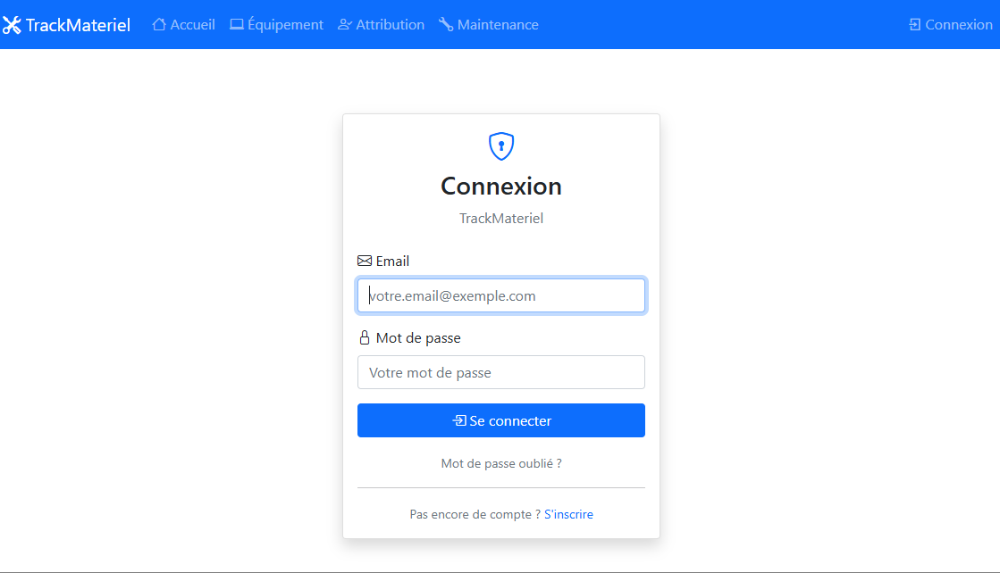
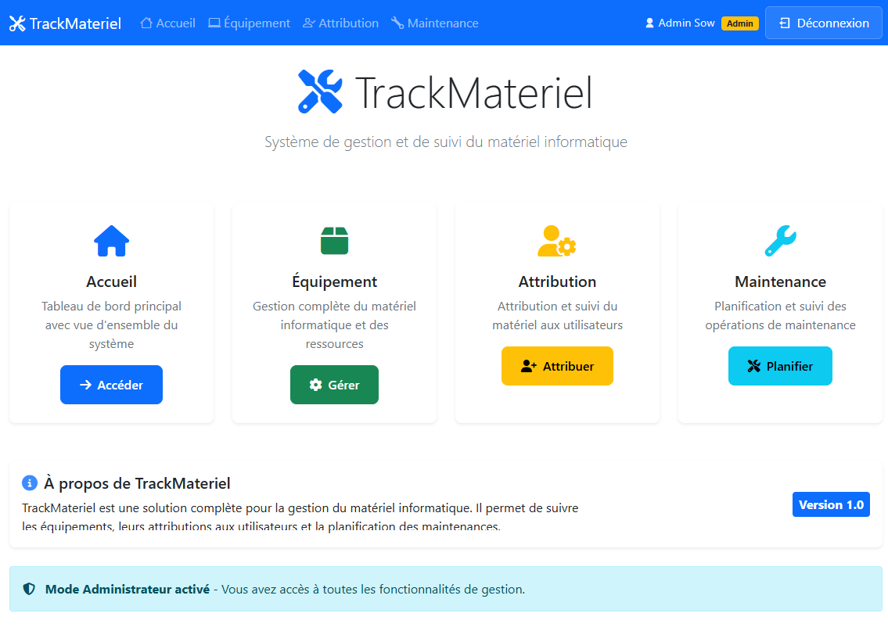
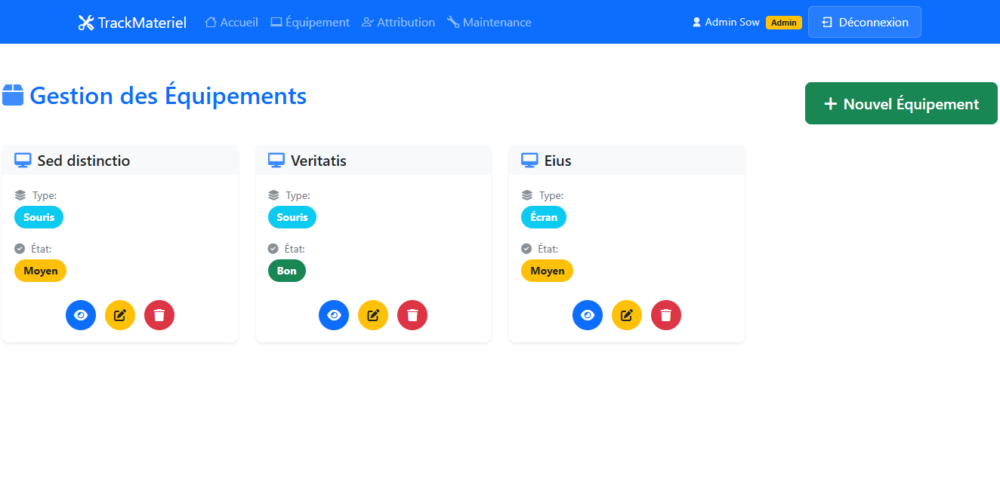
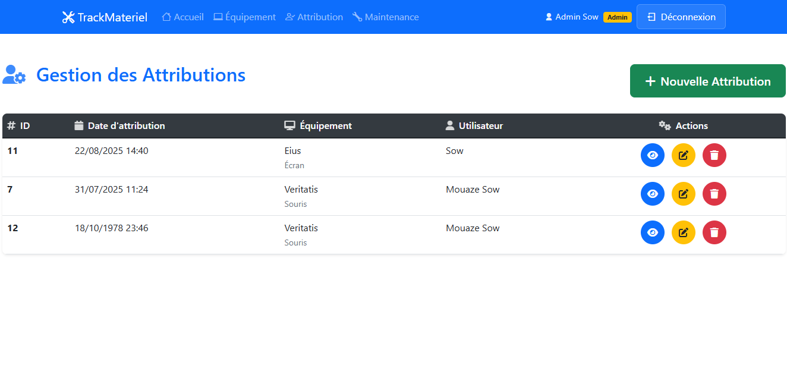
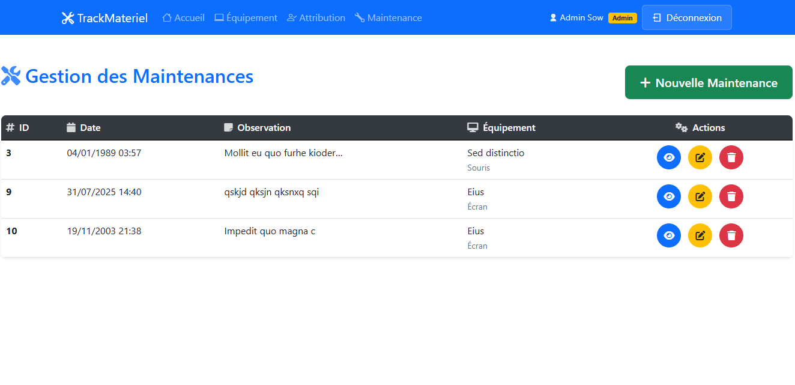

# 🖥️ TrackMateriel - Système de Gestion de Matériel

Une application web moderne développée avec Symfony 7 permettant de gérer et suivre l'attribution, la maintenance et le suivi des équipements informatiques dans une organisation.

## ✨ Fonctionnalités

- 🔐 **Système d'authentification** avec gestion des rôles (USER/ADMIN)
- 📦 **Gestion des équipements** avec types et états
- 👥 **Attribution d'équipements** aux utilisateurs
- 🔧 **Suivi des maintenances** avec observations détaillées
- 🔒 **Sécurité renforcée** avec CSRF protection

## 🛠️ Technologies utilisées

- 🐘 **PHP 8.2+**
- ⚡ **Symfony 7.3**
- 💾 **Doctrine ORM 3.5**
- 🗄️ **MySQL**
- 🎨 **Bootstrap 5.3**
- 🎯 **Stimulus.js**
- 🔧 **Turbo** pour une navigation fluide
- 📝 **Twig** pour les templates

## 📁 Structure du projet

```
TrackMateriel/
├── src/
│   ├── Controller/        
│   ├── Entity/            
│   ├── Repository/         
│   ├── Form/              
│   ├── EventListener/     
│   └── DataFixtures/      
├── templates/             
├── public/                
├── assets/                
├── config/                
├── migrations/            
└── tests/                 
```

## 📥 Installation

### Prérequis

- PHP 8.2 ou supérieur
- Composer
- PostgreSQL ou MySQL
- Serveur web (Apache/Nginx) ou Symfony CLI
- Git

L'application sera accessible à l'adresse : `http://localhost:8000`

## 🔐 Authentification

### Créer un compte 
Inscription
Créer un compte TrackMateriel 

## 📋 Fonctionnalités détaillées

### 👥 Gestion des utilisateurs
- Inscription et connexion sécurisées
- Gestion des rôles (USER/ADMIN)
- Profils utilisateurs personnalisés

### 📦 Gestion des équipements
- Ajout/modification/suppression d'équipements
- Classification par type (Ordinateur, Imprimante, etc.)
- Suivi des états (Bon, Moyen, Mauvais)
- Interface moderne avec cartes

### 👤 Attribution d'équipements
- Attribution d'équipements aux utilisateurs
- Historique des attributions
- Gestion des dates d'attribution
- Interface intuitive pour les administrateurs

### 🔧 Suivi des maintenances
- Création de tickets de maintenance
- Observations détaillées
- Association aux équipements
- Suivi par utilisateur

## 🔒 Sécurité

- **Authentification** : Formulaire de connexion sécurisé
- **Autorisation** : Gestion fine des permissions par rôle
- **CSRF Protection** : Protection contre les attaques CSRF

## 🤝 Contribution

Les contributions sont les bienvenues ! Voici comment vous pouvez contribuer :

1. 🍴 Fork le projet
2. 🌿 Créez une branche pour votre fonctionnalité 
3. ✍️ Commit vos changements 
4. 📤 Push vers la branche
5. 🔍 Ouvrez une Pull Request


## 📸 Captures d'écran

### Page de connexion


### Dashboard principal


### Gestion des équipements


### Attribution d'équipements


### Suivi des maintenances



## 🙏 Remerciements

- **Symfony Team** pour l'excellent framework
- **Doctrine Team** pour l'ORM puissant
- **Bootstrap Team** pour le framework CSS
- **Font Awesome** pour les icônes
- **Stimulus Team** pour le JavaScript moderne
- Tous les contributeurs qui ont participé au projet

## 📄 Licence

MIT

## 👨‍💻 Auteur

**[Thierno Maadjou Sow]**

### Contact
- 📧 Email: [thiernomaadjous@gmail.com]
<!-- - 💼 LinkedIn: []
- 🌐 GitHub: [] -->

⭐ Si ce projet vous a été utile, n'hésitez pas à lui mettre une étoile sur GitHub !
